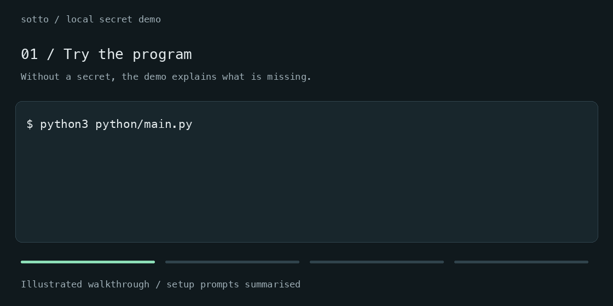
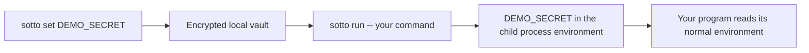

# Sotto examples

**One secret. Eight languages. No account required.**

Try [Sotto](https://github.com/getsotto/sotto) locally with a tiny terminal program.
Store `DEMO_SECRET` in an encrypted local vault, then let `sotto run` supply it to
your program. No SDK, application dependencies, server, or `.env` file needed.



*Animated walkthrough; first-run prompts are summarised. Copyable steps are below.*

[Python](python/) · [JavaScript](javascript/) · [TypeScript](typescript/) ·
[Java](java/) · [C#](csharp/) · [PHP](php/) · [Go](go/) · [C++](cpp/)

## Quick start with Python

You need Git and [Python 3](https://www.python.org/downloads/). Only install the
runtime for the example you want to try. The commands below run from the repository root.

### 1. Install Sotto and get the examples

**macOS / Linux**

```sh
curl -fsSL https://raw.githubusercontent.com/getsotto/sotto/main/install.sh | sh
export PATH="$HOME/.local/bin:$PATH"
git clone https://github.com/getsotto/sotto-example.git
cd sotto-example
sotto --version
```

**Windows (PowerShell, x64)**

```powershell
irm https://raw.githubusercontent.com/getsotto/sotto/main/install.ps1 | iex
$env:PATH = "$env:LOCALAPPDATA\sotto\bin;$env:PATH"
git clone https://github.com/getsotto/sotto-example.git
cd sotto-example
sotto --version
```

Already have Sotto? Skip the installer. You can also click **Use this template**
on GitHub and clone your own copy. For manual downloads and verification, see
[Sotto's installation instructions](https://github.com/getsotto/sotto#install).

### 2. See what happens without a secret

macOS / Linux:

```sh
python3 python/main.py
```

Windows:

```powershell
py -3 python/main.py
```

With `DEMO_SECRET` unset, the program exits with code `1` and explains the fix:

```text
DEMO_SECRET is missing or empty. Set it with `sotto set DEMO_SECRET`, then run this demo with `sotto run -- <command>`.
```

### 3. Create your local project and set the secret

These commands are the same on all three platforms:

```sh
sotto init
sotto set DEMO_SECRET
```

On your first-ever `sotto init`, choose and confirm a master password, then save
the printed **Emergency Kit** somewhere private. No signup is involved. If you
already use Sotto, it reuses your local identity and creates a new project for
this directory; you may be asked to unlock it.

At the hidden `Value:` prompt, enter `hello-from-sotto` and press Enter. This is
just a made-up demo value. Your typing will not appear in the terminal.

Initialise once at the repository root. All eight examples share this project.
Your generated `sotto.toml` is ignored by Git so each visitor creates their own project.

### 4. Run with Sotto

macOS / Linux:

```sh
sotto run -- python3 python/main.py
```

Windows:

```powershell
sotto run -- py -3 python/main.py
```

```text
Sotto demo: secret loaded successfully.
```

That's the demo: the program received a non-empty secret without reading a file
or using a Sotto SDK. It never prints the value. Any non-empty value, including
`0`, works; this checks presence, not whether an API key is valid.

Run Python directly again and it still reports the missing secret, provided
`DEMO_SECRET` was not already set in your shell. Sotto supplies the variable to
the child process; it does not export it into your terminal session.

## Try another language

After the same root-level setup, choose one example. Run these commands from the
repository root on macOS, Linux, or Windows PowerShell unless noted.

| Language | Prerequisite | Run |
| --- | --- | --- |
| [Python](python/) | Python 3 | `sotto run -- python3 python/main.py` (Windows: `sotto run -- py -3 python/main.py`) |
| [JavaScript](javascript/) | Node.js 24 LTS | `sotto run -- node javascript/main.js` |
| [TypeScript](typescript/) | Node.js 24.12+ | `sotto run -- node typescript/main.ts` |
| [Java](java/) | JDK 17+ | `sotto run -- java java/Main.java` |
| [C#](csharp/) | .NET 10 SDK | `sotto run -- dotnet run --project csharp/Demo.csproj` |
| [PHP](php/) | PHP 8 CLI | `sotto run -- php php/main.php` |
| [Go](go/) | Go 1.22+ | `sotto run -- go run go/main.go` |
| [C++](cpp/) | CMake 3.20+ and a C++17 compiler | Build first; see below. |

Node runs this small TypeScript example using its
[built-in type stripping](https://nodejs.org/api/typescript.html), so it needs no
package install. Java's source-file launcher and `go run` handle compilation for
their examples. C# uses the .NET SDK to build its dependency-free project.

For C++, install CMake and a compiler (Clang/GCC on macOS or Linux; Visual Studio
Build Tools with **Desktop development with C++** on Windows), then build:

```sh
cmake -S cpp -B cpp/build
cmake --build cpp/build --config Release
```

macOS / Linux:

```sh
sotto run -- ./cpp/build/demo
```

Windows PowerShell:

```powershell
sotto run -- .\cpp\build\demo.exe
```

Every example produces the same success message and returns `0`. A missing or
empty secret produces the same helpful error on stderr and returns `1`.

## How it works



`sotto set` encrypts the value into Sotto's local store. `sotto.toml` contains
project identifiers and the default environment, not secret values. `sotto run`
decrypts the project's active environment locally and supplies its secrets to the
command you launch. The running program receives plaintext and should not log it.

These demos do not call `login`, `push`, or any hosted service. Installation and
initial runtime setup need internet access; the secret workflow is local.
On Linux, Sotto needs an available, unlocked Secret Service keyring (such as
GNOME Keyring); see [troubleshooting](#troubleshooting) for headless machines.

## Troubleshooting

- **`sotto` not found:** add the install directory to your current shell's `PATH`
  using the command shown above. To keep it available in future terminals, add
  `~/.local/bin` to your shell configuration on macOS/Linux, or
  `%LOCALAPPDATA%\sotto\bin` to your user Path in Windows Environment Variables.
- **Python command not found:** verify `python3 --version` on macOS/Linux or
  `py -3 --version` on Windows. If your installation uses `python`, substitute
  it in both the direct and `sotto run` commands.
- **`sotto.toml` already exists:** setup is done for this checkout; continue with
  `sotto set DEMO_SECRET`. You do not need to initialise each language folder.
- **The direct run already succeeds:** `DEMO_SECRET` is already present in your
  shell. Unset it with `unset DEMO_SECRET` on macOS/Linux or
  `Remove-Item Env:DEMO_SECRET -ErrorAction SilentlyContinue` in PowerShell,
  then repeat the comparison.
- **Missing secret even with Sotto:** run `sotto set DEMO_SECRET` from the
  repository root and enter a non-empty value. Run all documented commands there.
- **Locked session:** run `sotto unlock` and enter your master password.
- **Linux keyring error:** use an unlocked desktop session with a Secret Service
  provider. A bare SSH session, container, or WSL installation may not have one;
  the local demo requires that keyring service to be configured first.

## Next steps

- [Sotto](https://github.com/getsotto/sotto): encrypted sync, teams, and the full CLI.
- [Sotto Action](https://github.com/getsotto/sotto-action): GitHub Actions setup and CI examples.
- [Maintaining the examples and animation](CONTRIBUTING.md).

## License

[Apache-2.0](LICENSE), like Sotto.
